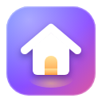

<p align="center">
  
</p>

<h1 align="center">My Home</h1>

<p align="center">
  A console-style home screen for every new Chrome tab: your favourite sites as tiles, with a live preview of the selected site behind them.
</p>

<p align="center">
  <a href="https://github.com/desmondlee95700/chrome-home/archive/refs/heads/main.zip"></a>
  
  
  
  <a href="LICENSE.md"></a>
</p>

---

## Contents

- [Installation](#installation)
- [Features](#features)
- [Controls](#controls)
- [Permissions and privacy](#permissions-and-privacy)
- [Optional: Google sign-in with OAuth](#optional-google-sign-in-with-oauth)
- [Development](#development)
- [License](#license)

## Installation

**Requirements:** Google Chrome or another Chromium browser. Google sign-in works in Google Chrome only.

My Home isn't on the Chrome Web Store yet, so it's installed as an unpacked extension.

1. Download **[chrome-home.zip](https://github.com/desmondlee95700/chrome-home/archive/refs/heads/main.zip)**, unzip it, and move the folder somewhere permanent, such as `Documents`. Or clone it:

   ```bash
   git clone https://github.com/desmondlee95700/chrome-home.git
   ```

2. Open `chrome://extensions` and turn on **Developer mode** (top right).
3. Click **Load unpacked** and choose the **`home-extension`** folder inside it.
4. Open a new tab (<kbd>⌘</kbd><kbd>T</kbd>) and click **Keep it** when Chrome asks.

> [!WARNING]
> Keep the folder where it is. Chrome loads the extension straight from that folder, so moving or deleting it removes the extension.

> [!TIP]
> To show My Home every time Chrome opens, go to **Settings → On startup** and choose **Open the New Tab page**.

### Updating

Replace the files with a newer download, or run `git pull` in the clone. Then click **↻** on the **My Home** card in `chrome://extensions`.

## Features

- **Site tiles.** Your favourite sites in a row, like a console home screen. The selected tile grows, glows and shows its name. Add, rename, change the link of or remove any site.
- **Logo-matched colours.** Each tile is painted in a deep version of its logo's colour, such as dark red for YouTube and deep blue for Google. Black-and-white logos get a neutral glass tile.
- **Full-screen previews.** The selected site fills the background with a softly blurred, slowly zooming preview that crossfades as you move between tiles.
- **Live previews (optional).** When you visit one of your sites, a snapshot of the page is saved and used as that tile's background, so you see your real feed. The site's own menu bar is cropped off.
- **Artwork and custom backgrounds.** A site's share image is used when it's real artwork; logo-only and plain white banners are skipped automatically. You can also set your own picture for any tile.
- **Search with suggestions.** Searches with your default search engine. Suggestions appear as you type, with matching home sites listed first.
- **Google profile.** Greets you with your Google photo and first name ("Good evening, Desmond") using the account already signed in to Chrome.
- **Settings.** 24-hour clock and Live previews, each a simple toggle with a short explanation.

### Background order

For each tile, the first available background is used:

| Order | Source | Notes |
| :---: | :--- | :--- |
| 1 | Your own image | Set from **••• → Change background**. Upload a file or paste an image link. |
| 2 | Live snapshot | Taken in your browser during your last visit. Refreshed at most every 10 minutes. |
| 3 | Share image | The banner a site shows when its link is shared, used only if it looks like real artwork. Cached for 3 days. |
| 4 | Colour glow | A soft glow in the logo's colour while nothing else is available. |

## Controls

### Keyboard

| Shortcut | Action |
| :---: | :--- |
| <kbd>←</kbd> <kbd>→</kbd> | Move between tiles. |
| <kbd>Enter</kbd> | Open the selected site, or add a new one on the **+** tile. |
| <kbd>O</kbd> | Open the options menu for the selected tile. Use <kbd>↑</kbd> <kbd>↓</kbd> to move and <kbd>Enter</kbd> to choose. |
| <kbd>/</kbd> | Open search. Use <kbd>↑</kbd> <kbd>↓</kbd> to pick a suggestion. |
| <kbd>Esc</kbd> | Close search or the options menu. |

### Mouse

| Click | Action |
| :--- | :--- |
| A tile | Selects it; click again to open the site. |
| **Open** | Opens the selected site. |
| **•••** | Rename or edit the link, change the background, or remove the site. |
| Your avatar | Connect or disconnect your Google account. |
| Settings / search icons | Open Settings or search. |

## Permissions and privacy

| Permission | When | Why |
| :--- | :--- | :--- |
| Storage | Always | Saves your sites and settings (synced with your Chrome profile) and backgrounds (this computer only). |
| Search | Always | Searches with your default search engine. |
| Identity / email | Always | Reads the email of the account signed in to Chrome. |
| Google suggestions and favicon service | Always | Search suggestions as you type, and reading logo colours. |
| All sites | Only after you click **Turn on** | Share images and Live previews. Snapshots never leave your computer. |
| `accounts.google.com` | Only after you click **Use my Google account** | Shows your Google name and photo. |

My Home has no analytics, no tracking and no servers of its own.

> [!NOTE]
> As with Chrome's address bar, what you type in search is sent to Google to fetch suggestions.

## Optional: Google sign-in with OAuth

**Use my Google account** reads the account already signed in to Chrome. That relies on an undocumented Google address, so you can set up the official sign-in once as a backup:

1. Load the extension and copy its **ID** from `chrome://extensions`. It stays the same as long as you don't move the folder.
2. In [Google Cloud Console](https://console.cloud.google.com/), create a project.
3. Under **APIs & Services → OAuth consent screen**, choose **External**, fill in the app name and your email, and add yourself under **Test users**.
4. Under **APIs & Services → Credentials → Create credentials → OAuth client ID**, choose **Chrome Extension** and enter the ID from step 1.
5. In `home-extension/manifest.json`, replace `YOUR_CLIENT_ID.apps.googleusercontent.com` with your client ID.
6. Reload the extension, then click your avatar → **Use my Google account**.

> [!NOTE]
> Google sign-in works in Google Chrome only, not in Edge, Brave or other Chromium browsers.

## Development

There's no build step and no dependencies. Edit the files in `home-extension/`, click **↻** on the extension's card, and open a new tab.

```bash
# Check the scripts and manifest
node --check home-extension/newtab.js home-extension/background.js
python3 -m json.tool home-extension/manifest.json > /dev/null

# Preview the page in any browser (Chrome extension APIs are unavailable here)
python3 -m http.server 8766 --directory home-extension
open http://localhost:8766/newtab.html
```

[`AGENTS.md`](AGENTS.md) covers how the code is organised, storage keys and conventions.

## License

Released under the [MIT License](LICENSE.md). Copyright © 2026 [Desmond Lee](https://github.com/desmondlee95700).
